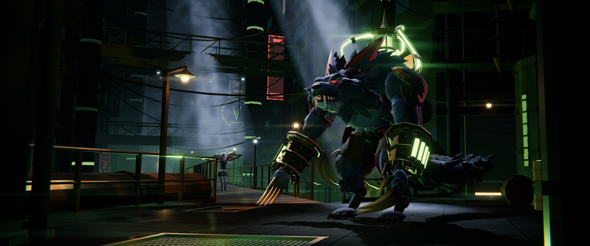

# Warwick · Furie de Zaun

Fond d'écran animé en 3D pour **Wallpaper Engine** (type « Web »), pensé pour les écrans ultra-larges
**21:9 (3440×1440)** et lisible sur les autres formats.

Nuit dans les bas-fonds de Zaun : brume chimique verte, puits de lumière froide tombant des grilles de
Piltover, métal humide et rouillé. Warwick, la Furie déchaînée de Zaun, se tient à droite de l'image ; la partie
gauche reste calme et sombre pour laisser respirer les icônes du bureau. De temps en temps il flaire l'air,
hurle, lacère le vide de ses griffes ou fait crisser ses lames. En **Traque sanglante**, toute la palette vire
au rouge. La scène peut aussi réagir à la musique.

> **Fan-art original et non officiel.** Tout est modélisé et animé par du code (Three.js, géométrie
> procédurale low-poly) : aucun modèle, texture, son ni logo de Riot Games n'est utilisé.
> *League of Legends* et *Warwick* sont des marques déposées de Riot Games, Inc. Ce projet n'est ni
> approuvé ni sponsorisé par Riot Games.



## Installation dans Wallpaper Engine

Utilisez le contenu de l'archive `warwick-wallpaper.zip` (dossier `dist/`) : il ne contient que les fichiers
nécessaires. Wallpaper Engine analyse tout le dossier du projet ; évitez d'y laisser des fichiers inutiles.

### Méthode 1 — Éditeur (recommandée, permet aussi la publication)

1. Décompressez l'archive dans un dossier dédié, par exemple `Documents\warwick-wallpaper\`.
2. Dans Wallpaper Engine, ouvrez l'**Éditeur** (bouton **Créer un fond d'écran** / *Create Wallpaper*, en bas à
   gauche de la fenêtre principale ; il est aussi accessible depuis *Wallpaper Editor* dans Steam).
3. **Glissez-déposez `index.html`** sur le bouton **Créer un fond d'écran** de l'éditeur. Wallpaper Engine
   copie le projet dans `wallpaper_engine\projects\myprojects\` et lit `project.json` (titre, aperçu,
   propriétés).
4. Fermez l'éditeur : le fond d'écran apparaît dans l'onglet **Installés**. Sélectionnez-le, les réglages
   s'affichent à droite.

Pour retrouver les fichiers copiés : dans l'éditeur, **Édition › Ouvrir dans l'explorateur**
(*Edit › Open in Explorer*).

### Méthode 2 — Copie directe

Copiez le dossier `warwick-wallpaper` (celui qui contient `project.json`) dans
`…\steamapps\common\wallpaper_engine\projects\myprojects\`, puis relancez Wallpaper Engine : il apparaît dans
l'onglet **Installés**.

### Méthode 3 — Essai rapide

Dans la fenêtre principale : **Ouvrir un fond d'écran › Ouvrir depuis un fichier** (*Open Wallpaper › Open
from File*), puis choisissez `index.html`. Pratique pour tester, mais les réglages de `project.json` ne sont
fiables qu'avec les méthodes 1 et 2.

### Publier sur le Workshop

Ouvrez le projet dans l'éditeur, puis menu **Workshop › Partager le fond d'écran sur le Workshop**
(*Share Wallpaper on Workshop*). Republier depuis le même projet met à jour l'objet existant. Pensez à
garder la mention « fan-art non officiel » dans la description.

## Réglages

Tous les réglages s'appliquent en direct, sans recharger la page.

| Réglage | Clé | Valeurs | Effet |
|---|---|---|---|
| Ambiance | `mode` | Chimie de Zaun · Traque sanglante · Cycle | *Cycle* alterne ~78 s de brume verte et ~32 s de traque rouge (grognement à l'entrée en traque). |
| Animations spontanées | `events` | oui / non | Flairer puis hurler, coup de griffe, crissement des lames, à intervalles aléatoires. |
| Face-à-face avec Briar | `duels` | oui / non | De temps en temps, Warwick sent Briar au fond de la ruelle : il se retourne, gronde, elle bondit vers lui en feulant, il lui rugit dessus et elle recule dans l'ombre (≈ 11 s). Le premier événement est toujours un face-à-face. |
| Intervalle des animations (s) | `eventinterval` | 10 – 120 (30) | Temps moyen entre deux animations (±40 % au hasard). Masqué si les animations sont coupées. |
| Mouvement de caméra | `camerasway` | oui / non | Lente dérive cinématique de la caméra. |
| Parallaxe à la souris | `parallax` | oui / non | La vue suit légèrement le pointeur. |
| Réaction à la musique | `audioreact` | 0 – 100 (60) | Force de la réaction au son de l'ordinateur : lumières chimiques du décor, réservoirs et yeux de Warwick, halo. 0 = aucune. |
| Qualité | `quality` | Basse · Moyenne · Haute · Ultra | Résolution de rendu, ombres, anticrénelage, densité de particules, résolution du halo. |
| Halo lumineux | `bloom` | 0 – 100 (60) | Intensité du bloom autour des lumières, des yeux et des liquides chimiques. |
| Particules | `particles` | 0 – 100 (70) | Densité des braises, gouttes et poussières (multipliée par le préréglage de qualité). |
| Afficher le titre | `showtitle` | oui / non | Affiche « WARWICK — La Furie déchaînée de Zaun » en bas à gauche (police Teko incluse). |
| Couleur chimique | `chemcolor` | couleur | Teinte de la brume et des liquides de Zaun. |
| Couleur de la traque | `bloodcolor` | couleur | Teinte de la Traque sanglante (yeux, lumières, ambiance). |

### Réaction à la musique

Wallpaper Engine transmet le spectre du son joué par l'ordinateur (64 bandes par canal, ~30 fois par seconde).
Le fond d'écran en tire les graves, médiums, aigus et un « battement » détecté sur les graves, avec un
**gain automatique lent** : une musique douce comme une musique forte produisent une réaction visible, et un
son continu reste modéré. Sans son, tout retombe en douceur à zéro.
Si rien ne réagit : vérifiez dans les **Paramètres** de Wallpaper Engine que l'enregistrement / le traitement
audio est activé et que le bon périphérique de sortie est choisi.

## Performances

Le fond d'écran tourne toute la journée : il est conçu pour rester léger (une seule lumière à ombres,
~450 appels de dessin et ~500 000 triangles au maximum en *Haute*, post-traitement compact).

- **Qualité** : *Haute* convient à une carte graphique de jeu milieu de gamme en 3440×1440. Sur portable ou
  GPU intégré, choisissez *Basse* (rendu à 60 % de la résolution, sans ombres) ou *Moyenne*.
  *Ultra* est réservé aux cartes haut de gamme.
- **Limite d'images (FPS)** : réglez-la dans **Paramètres › Performances** (réglage *FPS*) de Wallpaper Engine ;
  le fond d'écran la reçoit et la respecte. 30 i/s suffisent largement et divisent la charge par deux.
- **Pause** : dans **Paramètres › Performances**, choisissez « Pause » pour les cas « autre application au
  premier plan » et « autre application en plein écran ». Le fond d'écran s'arrête alors complètement (boucle de rendu suspendue) et
  reprend sans à-coup.
- *Particules* et *Halo lumineux* à 0 allègent encore le rendu.

## Aperçu dans un navigateur

Aucune installation ni serveur : tout fonctionne en local (`file://`), sans connexion réseau.
Ouvrez `index.html` dans Chrome, Edge ou Firefox. Les réglages se passent dans l'adresse avec les mêmes clés :

```
index.html?mode=hunt&quality=medium
index.html?mode=zaun&events=0&camerasway=0
index.html?chemcolor=0.2,0.8,1&bloodcolor=ff2a2a&showtitle=1
index.html?audiodemo&audioreact=100      (faux spectre musical à 120 BPM pour tester la réaction audio)
index.html?fps=30                         (simule la limite d'images de Wallpaper Engine)
```

Booléens : `0`/`false` = non, toute autre valeur (ou la clé seule) = oui. Couleurs : `r,g,b` entre 0 et 1, ou
hexadécimal `ff2a2a`. Ajouter `dev` expose `window.__ww` (état, déclencheurs) pour le débogage.

## Pour les développeurs

| Commande | Rôle |
|---|---|
| `node dev/shoot.js --w 1720 --h 720 --out /tmp/x --states idle,howl,swipe,hunt` | Captures headless de chaque animation + appels de dessin / triangles. |
| `node dev/preview.js [--state idle\|howl\|hunt] [--title]` | Régénère `preview.jpg` (720×720 centré sur Warwick, < 500 Ko) et `dev/preview-21x9.jpg` (3440×1440). |
| `bash dev/package.sh` | Vérifie `project.json` (clés identiques à `js/main.js`) et construit `dist/warwick-wallpaper.zip`. |

Les scripts `dev/` utilisent Playwright (Chromium headless avec SwiftShader : rendu lent, ne pas juger les FPS).

Structure : `index.html` (page) · `js/main.js` (orchestration, caméra, scénario) · `js/warwick.js` (personnage)
· `js/environment.js` (décor, lumières, particules) · `js/post.js` (post-traitement) · `js/wallpaper.js`
(pont Wallpaper Engine : propriétés, audio, FPS, pause) · `lib/` (Three.js r128) · `fonts/` (Teko).
Le contrat technique entre modules est décrit dans `CONTRACT.md`.

## Crédits et licences

- Rendu : [Three.js](https://threejs.org) r128 — licence MIT (en-tête conservé dans `lib/three.min.js`).
- Police : **Teko** (Indian Type Foundry / The Teko Project Authors) — SIL Open Font License 1.1,
  voir `fonts/OFL.txt`.
- Personnage : *Warwick* © Riot Games ; interprétation de fan, sans aucun élément officiel.
